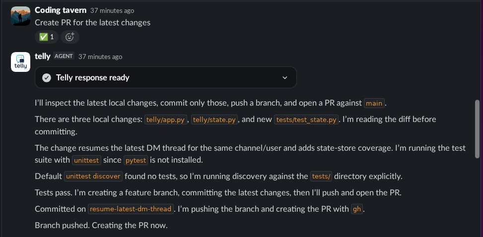

# slack-tmux

Chat-facing coding agent that runs local coding CLIs in resumable tmux-backed sessions. Works on **Slack** and **Telegram** — run either or both at once.

Telly uses Slack's latest agent surfaces:

- **Text streaming** (`chat.startStream` / `appendStream` / `stopStream`) with plan-mode task updates
- **Assistant status** + loading messages while the local agent runs
- **Markdown / table / plan / visualization** Block Kit for answers
- **Feedback buttons** + modal on thumbs-down
- Compatible with **agent_view** (Messages tab) and legacy **assistant_view**

See `manifest.agent.yaml` for scopes and event subscriptions to enable in the Slack app settings.

## Setup

```bash
python3 -m venv .venv
. .venv/bin/activate
pip install -r requirements.txt
cp .env.example .env
```

Fill in the Slack credentials in `.env` before running. Enable the **Agents** feature on the app and subscribe to the events listed in `manifest.agent.yaml`.

## Run

```bash
python -m telly
```

Telly starts whichever backends have credentials in `.env` — Slack, Telegram, or both. Neither needs a public URL or any hosting: Slack uses Socket Mode and Telegram uses long polling, both outbound-only, so it runs happily on your laptop.

## Telegram

Set `TELEGRAM_BOT_TOKEN` (from [@BotFather](https://t.me/BotFather)) and start telly — no webhook, no deploy:

```bash
TELEGRAM_BOT_TOKEN=123456:ABC-... python -m telly
```

Telegram gets full feature parity with Slack, expressed the Telegram way:

- **Live thinking steps** — a "working" message is edited in place with each tool call, then replaced by the final answer.
- **Rich formatting** — agent Markdown → Telegram HTML; tables and charts render as aligned `monospace` blocks; cards/plans/alerts as native HTML; images and videos arrive as real Telegram photo/video messages.
- **Inline controls** — 👍/👎 feedback (with a follow-up category keyboard), Regenerate, Fork, Stop, and **Approve/Deny** for actions that need confirmation.
- **Commands** — `/new`, `/status`, `/sessions`, `/stop`, `/triggers`, `/help`, and a `/start` welcome with suggested-prompt buttons.
- **Reactions** — ⏳ on your message while working, ✅ when done.
- **Attachments** — send a document/photo and telly downloads it for the agent; `SLACK_UPLOAD:` markers come back as files.
- **Triggers** — the same `add/set/start/stop/list trigger` grammar as Slack, per chat.

Restrict access with `ALLOWED_TELEGRAM_USER_IDS` / `ALLOWED_TELEGRAM_CHAT_IDS` (comma-separated numeric ids).

> Note: in groups, disable the bot's privacy mode (via @BotFather) or @mention it, so it can see messages.

## Coding Agents

`MAIN_AGENT_CMD` picks the local CLI telly drives. Each Slack thread gets its own resumable session.

- **Command Code** (`MAIN_AGENT_CMD=command-code`, alias `cmd`) — run headless via `command-code -p --output-format json --yolo --trust --skip-onboarding`. Telly reads the NDJSON event stream (tool activity + streaming text) for live plan updates, resumes via `--resume <sessionId>`, and prepends its system prompt to each turn (Command Code has no `--append-system-prompt` flag). Defaults to `deepseek/deepseek-v4.1-flash`; override with `COMMAND_CODE_MODEL`.
- **OpenCode** (`MAIN_AGENT_CMD=opencode`) — the default, run with `opencode run --format json`.
- **Claude Code–compatible CLIs** — anything else is invoked as `-p --output-format json --permission-mode bypassPermissions`, with Playwright MCP injected for `claude`.

Run `/telly status` in Slack to confirm which CLI is active. Telly auto-discovers installed agents on `PATH` and reports them to the brain.

## Browser Automation

Telly gives spawned Claude/OpenCode turns a Playwright MCP server when `npx` is available. MCP is the first choice for interactive browser debugging, form flows, console/network inspection, and persistent page state. It uses telly's dedicated Chrome profile at `~/.telly/chrome-profile`, not the user's normal Chrome profile, and writes MCP artifacts under `~/.telly/playwright-mcp`.

Telly also includes a local Chrome/Playwright helper for deterministic rendered page text, DOM, screenshots, PDFs, and scripted interactions:

```bash
python -m telly.browser text https://example.com
python -m telly.browser screenshot https://example.com --output page.png
```

The helper is the fallback when MCP cannot complete a task or when a deterministic capture/action is better. It uses the same dedicated Chrome profile by default so normal Chrome sessions are not disturbed. If that profile is locked by MCP, use a task-specific `--profile PATH` for the login/action flow. Set `TELLY_PLAYWRIGHT_MCP=0` to disable MCP injection and keep only the helper commands.

Command Code has no inline MCP-config flag, so telly does not inject the Playwright MCP server for it — Command Code turns use the `telly.browser` helper (or a server you add yourself with `cmd mcp add`).

## Slack Native Visualizations

Telly can render Slack-native chart blocks from assistant replies.


